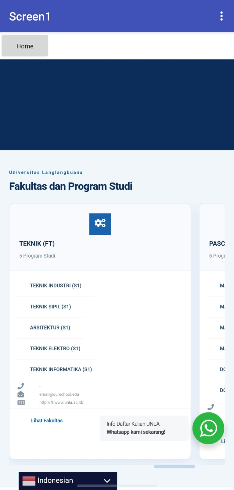
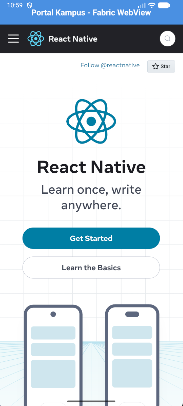

# Prototyping WebView App: MIT App Inventor → React Native

Aplikasi WebView yang dikembangkan dengan metode **Prototyping** dalam dua siklus.

| Siklus | Teknologi | Peran |
|--------|-----------|-------|
| 1 | MIT App Inventor | Prototype awal (cepat, low-code) |
| 2 | React Native (CLI) | Prototype lanjutan hasil evaluasi siklus 1 |

## Deskripsi dan Tujuan Aplikasi

Aplikasi menampilkan sebuah website di dalam aplikasi mobile menggunakan komponen WebView, sehingga konten web dapat dibuka tanpa berpindah ke browser. Pengembangan dilakukan dua kali dengan metode Prototyping: prototype cepat di MIT App Inventor, lalu disempurnakan di React Native.

**URL yang ditampilkan:**

- **Siklus 1:** https://www.unla.ac.id (website Universitas Langlangbuana)
- **Siklus 2:** https://reactnative.dev (website resmi React Native, dipakai untuk pengujian WebView)

## Metode Pengembangan: Prototyping

Alur: Pengumpulan Kebutuhan → Desain Cepat → Bangun Prototype → Evaluasi → Perbaikan → Siklus Berikutnya.

### Siklus 1: MIT App Inventor (Prototype Awal)

**1. Pengumpulan kebutuhan**

- Aplikasi dapat membuka website melalui komponen WebView.
- Tersedia tombol **Home** untuk kembali ke halaman awal.

**2. Desain cepat**

- Satu layar (`Screen1`) berisi tombol Home dan komponen WebView yang memenuhi layar.

**3. Prototype dibangun**

- File proyek: [`aplikasi_sederhana.aia`](./aplikasi_sederhana.aia)
- Cara membuka: impor file `.aia` di [ai2.appinventor.mit.edu](https://ai2.appinventor.mit.edu) lewat menu Projects → Import project.



**4. Evaluasi siklus 1**

| Aspek | Temuan |
|-------|--------|
| Kelebihan | Cepat dibuat tanpa coding, WebView berhasil menampilkan website UNLA, tombol Home berfungsi sebagai navigasi dasar |
| Kekurangan | Judul aplikasi masih default (`Screen1`), tampilan konten web terpotong di sisi kanan layar, kustomisasi terbatas, sulit dikelola dengan version control |
| Kebutuhan baru | Judul aplikasi yang sesuai, tampilan yang lebih rapi di layar, kode yang bisa dikelola lewat Git, dan dukungan lintas platform |

### Siklus 2: React Native WebView (Prototype Lanjutan)

**1. Kebutuhan hasil evaluasi**

- Header dengan judul aplikasi yang jelas, menggantikan judul default.
- Tampilan WebView yang memenuhi layar dengan rapi.
- Kode sumber yang dapat dikelola di Git dan dikembangkan lebih lanjut.

**2. Desain perbaikan**

- Aplikasi dibangun ulang dengan React Native dan TypeScript.
- Header aplikasi diberi judul **"Portal Kampus - Fabric WebView"**.
- WebView menampilkan halaman web secara penuh di bawah header.

**3. Prototype dibangun**

- Framework: React Native CLI (`@react-native-community/cli`)
- Bahasa: TypeScript
- Library utama: `react-native-webview`
- Kode utama: [`App.tsx`](./App.tsx)



**4. Evaluasi siklus 2**

| Aspek | Temuan |
|-------|--------|
| Kelebihan | Header kustom, tampilan web utuh dan responsif, kode dapat di-version control, kustomisasi penuh, dapat dikembangkan untuk Android dan iOS |
| Kekurangan | Setup lingkungan lebih rumit (Node.js, JDK, Android Studio) dan memerlukan pengetahuan JavaScript/TypeScript |

## Perbandingan Kedua Siklus

| Aspek | Siklus 1 (App Inventor) | Siklus 2 (React Native) |
|-------|-------------------------|--------------------------|
| Kecepatan pembuatan | Sangat cepat | Sedang |
| Kemampuan kustomisasi | Terbatas | Tinggi |
| Kebutuhan coding | Tidak ada | TypeScript/JSX |
| Judul aplikasi | Default (`Screen1`) | Kustom ("Portal Kampus - Fabric WebView") |
| Tampilan konten web | Sebagian terpotong | Tampil penuh |
| Version control (Git) | Sulit | Mudah |
| Platform | Android | Android dan iOS |

**Kesimpulan:** Siklus 1 dengan MIT App Inventor efektif untuk membuktikan ide dengan cepat: website dapat ditampilkan lewat WebView dan diuji di perangkat. Evaluasi siklus 1 menunjukkan keterbatasan pada tampilan, judul, dan pengelolaan kode, sehingga siklus 2 dengan React Native memperbaikinya dengan header kustom, tampilan yang lebih rapi, dan kode yang dapat dikelola di GitHub. Dengan Prototyping, perbaikan dilakukan bertahap berdasarkan hasil evaluasi, bukan menunggu produk akhir.

## Cara Menjalankan

### Siklus 1: MIT App Inventor

1. Buka [ai2.appinventor.mit.edu](https://ai2.appinventor.mit.edu).
2. Pilih **Projects → Import project (.aia)**, lalu pilih `aplikasi_sederhana.aia`.
3. Jalankan lewat **MIT AI2 Companion**, atau buat APK lewat **Build → Android App (.apk)**.

### Siklus 2: React Native CLI

Prasyarat: Node.js, JDK, Android Studio (emulator atau HP dengan USB debugging).

```bash
git clone https://github.com/Ramaadhan/PemrogramanMobileWebViewFabric
cd PemrogramanMobileWebViewFabric
npm install
npm start
```

Buka terminal kedua, lalu jalankan:

```bash
npm run android
```

## Struktur Repository

```
.
├── android/                 # proyek native Android
├── ios/                     # proyek native iOS
├── __tests__/
├── screenshots/
│   ├── Siklus_1.jpeg
│   └── Siklus_2.png
├── aplikasi_sederhana.aia   # siklus 1 (MIT App Inventor)
├── App.tsx                  # siklus 2 (React Native)
├── app.json
├── package.json
└── README.md
```

## Teknologi

- MIT App Inventor (siklus 1)
- React Native CLI dan TypeScript (siklus 2)
- react-native-webview

## Catatan

Dibuat untuk keperluan tugas perkuliahan (Ujian Tengah Semester, Pemrograman Mobile).
